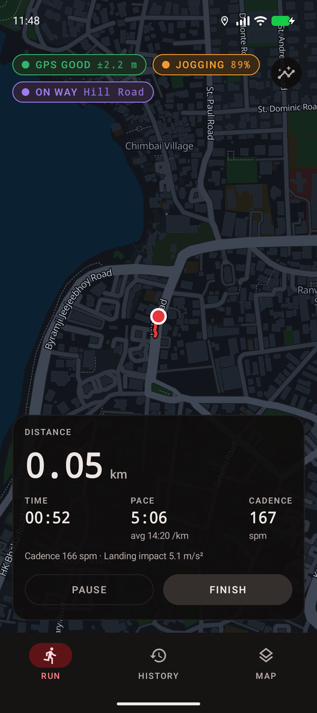
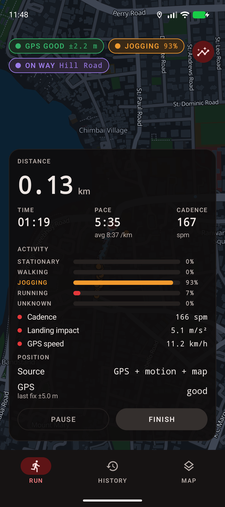
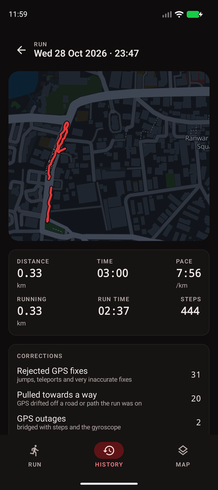
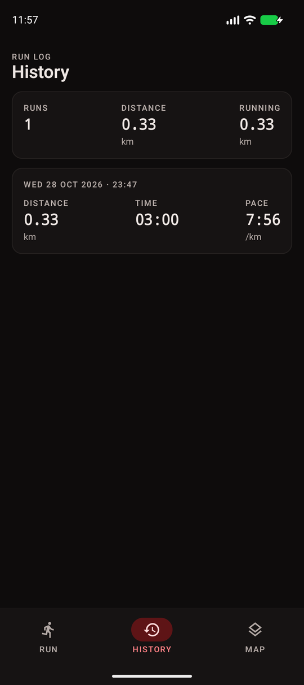
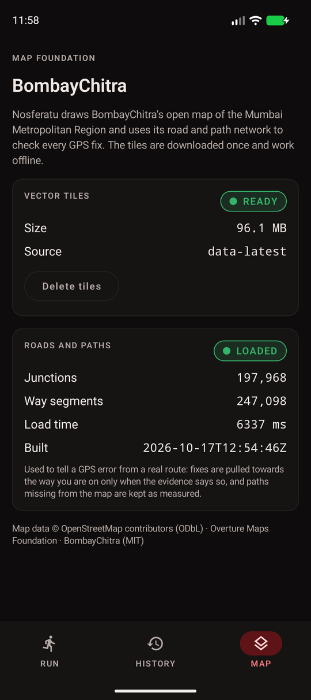

# Nosferatu

An open-source Android run tracker for the Mumbai Metropolitan Region that tells you **how sure it is**.

Nosferatu fuses raw GPS with the phone's accelerometer and gyroscope, checks every fix against
[BombayChitra](https://github.com/AmmaarBakshi/BombayChitra)'s open map of roads and paths, and decides whether you
are standing, walking, jogging or running from your gait, not just your speed. When GPS jumps, drifts or drops out
in Mumbai's narrow lanes and under flyovers, it says so, shows what it corrected, and keeps going on steps and the
gyroscope.

- **BombayChitra is the map.** Its vector tiles, its own dark style and its routing graph, offline, drawn by
  MapLibre Native. No Google Maps, no Play services.
- **Road-aware, never snap-happy.** An HMM map matcher with an explicit *off-network* state pulls the track towards a
  road only when the evidence says you're on it, and keeps unmapped paths as measured.
- **Running detection with evidence.** A hidden Markov model over cadence, step regularity and landing impact. A
  brisk walk at 7 km/h stays a walk; a fast run at 18 km/h is still a run; a bus ride is not a run.
- **Everything is auditable.** A diagnostics view shows raw fixes, rejected and down-weighted fixes, the matched way,
  the classifier's posterior and its evidence. Every run's raw sensor stream is saved and can be replayed; a run the
  app died in is rebuilt from it at the next launch.

<p align="center">
  
  
  
</p>
<p align="center">
  
  
</p>
<p align="center"><sub>Screenshots from an Android 16 emulator driven by <code>scripts/emulator_run.py</code>.</sub></p>

## Status

Phases A–G of the [implementation plan](docs/integration-assessment.md) are in place: BombayChitra integration, live
tracking in a foreground service, the fusion engine, map matching, activity detection, run history, and a
simulation-based validation suite. The numbers in [docs/validation.md](docs/validation.md) come from simulated runs
and one emulator run; **they are not yet measured on real phones outdoors.** Battery use has not been measured.

## Build

Requirements: JDK 17–21 (Android Studio's bundled JBR works; JDK 25 is too new for this AGP), the Android SDK with
platform 36, and Python 3.10+ for the asset script.

```sh
# 1. Bundle BombayChitra's road and path graph (~14 MB). Optional: without it, tracking runs on GPS and motion only.
python scripts/bombaychitra_assets.py graph --release          # downloads bombaychitra.db (~230 MB) first
#    or, from a local BombayChitra build:
python scripts/bombaychitra_assets.py graph --db ../BombayChitra/data/build/bombaychitra.db

# 2. Build and install.
./gradlew :app:assembleDebug
./gradlew :app:installDebug
```

The styles and glyphs are already committed. To refresh them from a BombayChitra checkout and a running
`bombaychitra serve`:

```sh
python scripts/bombaychitra_assets.py styles --server http://localhost:8080
python scripts/bombaychitra_assets.py fonts --checkout ../BombayChitra
```

### Map tiles

The first time, open the **Map** tab and tap *Download map*: about 96 MB from BombayChitra's `data-latest` release,
verified against its `SHA256SUMS`, then used offline. During development you can push a local file instead. Launch
the app once first so it creates its own directory (a directory created by `adb` is not readable by the app):

```sh
adb push bombaychitra.pmtiles /sdcard/Android/data/dev.nosferatu/files/bombaychitra/
```

On Git Bash for Windows, set `MSYS_NO_PATHCONV=1` first or the path gets mangled.

## Test

```sh
./gradlew test
```

- `:engine` has unit tests for every component, plus `ScenarioTest`: a dozen simulated runs (normal run, brisk walk,
  runs at 9–18 km/h, GPS jumps, a 25 s outage, five minutes standing with drifting GPS, a bus ride, parallel roads
  and junctions, an unmapped diagonal path, sharp turns and stops, phone rotation, a stuck Doppler bearing, no map)
  replayed through the whole tracker and scored against ground truth. Run with `-i` to see the metrics lines.
- `:bombaychitra` tests the graph decoder against encoded fixtures, and `RealGraphTest` runs against BombayChitra's
  real graph when it is available: the extracted `app/src/main/assets/bombaychitra/graph.db`, or any
  `bombaychitra.db` passed with `-Pbombaychitra.db=/path/to/bombaychitra.db`. Without either, it is skipped.
- `:app` tests the pure presentation and formatting code.

### On an emulator

`scripts/emulator_run.py` drives an emulator through a run: GPS along a real street (from a BombayChitra server or
a GeoJSON file) with noise, jumps and outages, plus a running gait on the accelerometer, so the whole app pipeline
runs as it would outdoors.

```sh
python scripts/emulator_run.py --street 1443 --seconds 160 --jump 60 --outage 100:20   # Hill Road, Bandra
```

### Replaying a real run

Each run is saved as `Android/data/dev.nosferatu/files/runs/<id>/trace.txt`, the raw GPS, accelerometer and
gyroscope stream. Pull it with `adb pull` and feed it to `Replay.run(TraceFormat.read(…), Tracker(network))` to
reprocess it with a newer engine, or add ground truth (`T` lines) to score it.

## Documentation

- [Architecture and data flow](docs/architecture.md)
- [The BombayChitra integration layer](docs/bombaychitra.md)
- [Integration assessment (Phase A)](docs/integration-assessment.md)
- [Capabilities and limitations](docs/capabilities.md)
- [Validation report](docs/validation.md)

## Design

The UI follows [OrangeXP](https://github.com/AmmaarBakshi/OrangeXP)'s design language: warm ink neutrals, one
accent (here a blood red), monospace numerals that read like instruments, uppercase letter-spaced captions,
bordered cards and state pills.

## License

Code: MIT, see [LICENSE](LICENSE). Map data from BombayChitra: © OpenStreetMap contributors (ODbL) and Overture Maps
Foundation; BombayChitra's code is MIT. Noto Sans glyphs: SIL Open Font License.
