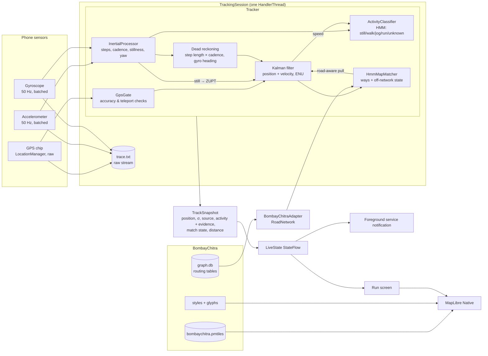

# Architecture

Nosferatu is three Gradle modules with a strict dependency direction:

```
:app  ──►  :bombaychitra  ──►  :engine
  └────────────────────────────►  :engine
```

| Module | What it is | Android? |
|---|---|---|
| `:engine` | The tracking engine: Kalman filter, IMU processing, activity HMM, map-matching HMM, the tracker that fuses them, the trace format, the simulator and the replay/metrics harness. Knows nothing about BombayChitra or Android; talks to maps only through the `RoadNetwork` interface. | No (plain JVM) |
| `:bombaychitra` | The integration layer. Reads BombayChitra's own data (its MapLibre styles, its routing graph blobs) and exposes them to the engine as a `RoadNetwork`. The only module that knows BombayChitra's formats. | No (plain JVM) |
| `:app` | The Android app: sensors, foreground service, storage, MapLibre rendering, Compose UI. | Yes |

Because the engine and the adapter are plain JVM code, everything that matters for accuracy is unit-tested on a
laptop, including against BombayChitra's real dataset (`RealGraphTest`).

## Data flow during a run



### Step by step, per GPS fix

1. **Record.** The raw fix goes to the run's trace file before anything else touches it.
2. **Gate.** `GpsGate` rejects fixes with absurd accuracy (> 50 m) or implied speed (> 12 m/s from the last good
   fix), and down-weights merely poor ones (σ × 1.5 above 20 m).
3. **Filter.** The Kalman filter predicts to the fix time, computes the innovation, and either rejects the fix
   (χ² > 13.8), inflates its σ (χ² > 9.2) or applies it. Doppler speed and bearing update the velocity, unless the
   bearing disagrees with the fixes' own course or repeats exactly (a stuck chip). A still phone (from the IMU)
   gets a zero-velocity update instead, which is what stops a parked phone from walking off on GPS drift.
4. **Match.** The online HMM map matcher scores BombayChitra ways near the fix (foot-accessible ones only) plus an
   explicit *off-network* state, using distance (heavy-tailed), heading, and network distance between consecutive
   candidates. It reports `Matched`, `Ambiguous`, `OffNetwork` or `NoCoverage` with a posterior confidence.
5. **Road-aware pull.** Only when matched with confidence, the filter gets a soft cross-track measurement towards
   the way, with σ from the way's half-width divided by the confidence. It is never a snap: an ambiguous or
   off-network match applies no pull, so unmapped paths keep their measured shape.
6. **Account.** Distance accumulates from the corrected track, only while on foot.

Between fixes the IMU runs continuously; if GPS is lost, dead reckoning carries the position with step length
(learned from good GPS) × cadence along the gyro heading, for up to 60 s, with growing σ. When GPS returns, three
consistent fixes that the filter keeps rejecting trigger a recovery: the filter re-initialises on GPS.

### Activity

The activity HMM's evidence is mostly gait: cadence, step regularity and landing impact (vertical RMS) from the
accelerometer, in a frame aligned to gravity so phone orientation doesn't matter. GPS speed is soft evidence with a
deliberately flat likelihood for running between 2.8 and 7.5 m/s, so a fast runner (> 8 km/h, or 18 km/h) is still
running and a brisk walker at 7 km/h is still walking. Moving fast with no steps is `Unknown` (a vehicle), never
running. Each estimate carries its posterior over all activities and the evidence list, which the UI shows.

## BombayChitra integration

See [bombaychitra.md](bombaychitra.md) for the details. In short:

- **Tiles.** BombayChitra's PMTiles archive, read in place by MapLibre Native's `pmtiles://` support. Downloaded
  once from BombayChitra's `data-latest` release and verified against its `SHA256SUMS`.
- **Style.** BombayChitra's own generated dark/light styles, shipped unmodified; `BombayChitraStyle.offline()`
  rewrites only the `bc` source URL and the glyph URL. A "quiet" variant hides the POI and house-number layers on
  the run map by visibility only.
- **Roads and paths.** BombayChitra's `routing` table (the same blobs its Go router uses), shipped as `graph.db` and
  decoded by `BombayChitraGraph`, which mirrors the Go loader's validation. `BombayChitraRoadNetwork` answers
  candidate queries from a grid index and network distances with a bounded Dijkstra.
- **Coverage.** `BombayChitraDataset.Bounds` is the MMR. Outside it the matcher reports `NoCoverage` and the
  tracker runs on GPS and motion alone.

Nosferatu's own drawing (position, uncertainty circle, trail, raw fixes, corrections, matched way) is added as
`nf-*` layers above all of BombayChitra's, so BombayChitra's look is unchanged underneath.

## App structure

| Package | Role |
|---|---|
| `sensors` | `GpsSource` (raw GPS provider, no Play services) and `ImuSource` (batched accelerometer + gyroscope). |
| `tracking` | `TrackingSession` (one run, one thread), `TrackingController` (app-wide owner), `TrackingService` (foreground service of type `location` with a partial wake lock). |
| `data` | `MapDataRepository` (tile download/verify), `RoadGraphRepository` (graph extraction and loading), `RunStore` (summaries and traces). |
| `map` | `BombayChitraMap` (MapLibre `MapView` in Compose), `NosferatuLayers` (the `nf-*` overlay), `MapStyleProvider`. |
| `ui` | Compose screens: Run, History, Run detail, Map data; OrangeXP-style components and theme. |

## Threading

All engine work for a run happens on one `HandlerThread`: GPS callbacks are registered on its looper, sensor
listeners on its handler, and the one-second tick is posted to it. The tracker therefore needs no locks and sees
events in timestamp order. The UI only reads an immutable `LiveState` from a `StateFlow`.

## Traces and replay

Every run's raw stream is saved as text (`# nosferatu-trace 1`; one line per GPS fix, accelerometer sample,
gyroscope sample, ground-truth point or note). `Replay.run()` feeds a trace through a fresh `Tracker` with the same
timing, and `Metrics.of()` scores it against ground truth when the trace has `T` lines (simulated runs do). This is
how every scenario in `ScenarioTest` runs, and how a real run can be re-processed by a newer engine.
